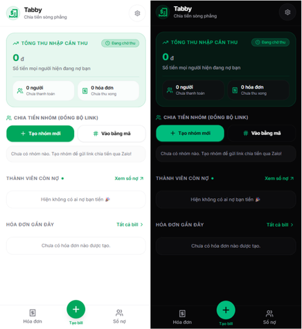
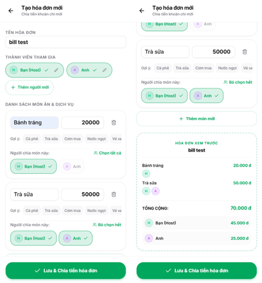
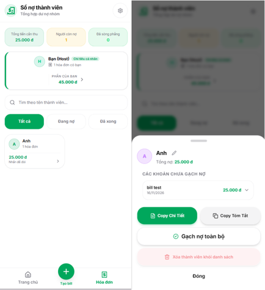
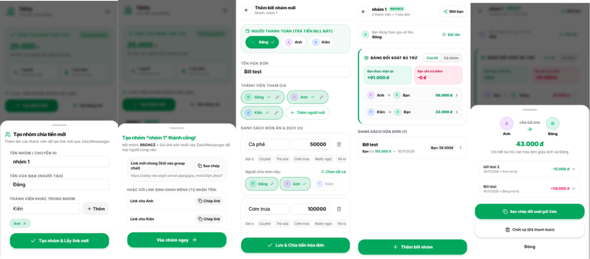
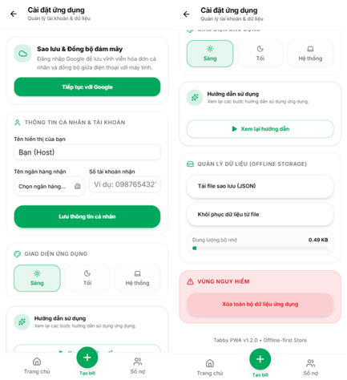

# Tabby

**Tabby** là ứng dụng web được thiết kế theo hướng Mobile-first, giúp quản lý hóa đơn, chia tiền và theo dõi công nợ giữa các thành viên trong nhóm một cách đơn giản, minh bạch.

Thay vì phải tính toán thủ công từng khoản chi, Tabby cho phép người dùng ghi nhận từng món trong hóa đơn, lựa chọn những người tham gia và tự động tính toán số tiền mỗi người cần thanh toán.

🔗 **Live Demo:** https://tabby-eta-eight.vercel.app/

---

## 📸 Screenshots

### Overview

<!-- Thay đường dẫn bằng ảnh thực tế -->



### Invoice Management

<!-- Có thể ghép ảnh tạo hóa đơn và chi tiết hóa đơn -->



### Debt Management



### Group Management

<!-- Có thể ghép ảnh tạo nhóm và chi tiết nhóm -->



### Settings



---

## ✨ Features

### Invoice Management

- Tạo và quản lý hóa đơn.
- Thêm từng món ăn hoặc khoản chi với tên và giá tiền.
- Lựa chọn thành viên tham gia từng món.
- Tự động chia đều chi phí giữa những thành viên được chọn.
- Theo dõi người thanh toán hóa đơn.
- Cập nhật trạng thái thanh toán: hoàn thành hoặc một phần.

### Automatic Bill Splitting

- Tự động tính số tiền mỗi thành viên cần trả.
- Tổng hợp chi phí theo từng thành viên.
- Theo dõi công nợ từ các hóa đơn.
- Xác định thành viên cần chuyển tiền và số tiền tương ứng.
- Tra cứu chi tiết khoản nợ theo từng hóa đơn và từng khoản chi.

### Group Management

- Tạo nhóm và quản lý thành viên.
- Tham gia nhóm thông qua mã nhóm hoặc đường dẫn mời.
- Đường dẫn mời có thể chứa mã thành viên để xác định người tham gia.
- Các thành viên có thể cùng tạo và chỉnh sửa hóa đơn.
- Theo dõi công nợ và các khoản thanh toán trong nhóm.

### Data Management

- Sử dụng ứng dụng mà không bắt buộc đăng nhập.
- Lưu dữ liệu cá nhân trên `localStorage`.
- Xuất dữ liệu thành file JSON để sao lưu và khôi phục.
- Liên kết tài khoản Google để đồng bộ và lưu trữ dữ liệu cá nhân trên MongoDB.

---

## 🛠️ Tech Stack

| Category         | Technologies              |
| ---------------- | ------------------------- |
| Framework        | Next.js 16 (App Router)   |
| Language         | TypeScript                |
| UI Library       | React 19                  |
| Styling          | Tailwind CSS 4            |
| UI Components    | shadcn/ui, Base UI        |
| State Management | Zustand                   |
| Form Management  | React Hook Form           |
| Validation       | Zod                       |
| Authentication   | NextAuth.js, Google OAuth |
| Database         | MongoDB                   |
| Animation        | Framer Motion             |
| Icons            | Lucide React              |
| Notifications    | Sonner                    |

**Architecture:** Feature-based Architecture

Next.js được sử dụng cho cả frontend và backend, giúp tổ chức ứng dụng trong một codebase thống nhất.

---

## 💾 Data Storage

Tabby hỗ trợ hai hình thức lưu trữ dữ liệu cá nhân:

| Trạng thái           | Cơ chế lưu trữ                              |
| -------------------- | ------------------------------------------- |
| Chưa liên kết Google | Lưu dữ liệu trên localStorage của thiết bị  |
| Đã liên kết Google   | Đồng bộ và lưu dữ liệu cá nhân trên MongoDB |

Người dùng có thể sử dụng các chức năng cá nhân mà không cần tạo tài khoản ngay từ đầu.

Để hạn chế rủi ro mất dữ liệu khi sử dụng trên thiết bị, Tabby cung cấp chức năng xuất dữ liệu JSON và khôi phục dữ liệu từ file sao lưu.

**Group Data:** Dữ liệu nhóm được thiết kế để lưu trữ trên MongoDB. Phần backend và tích hợp cơ sở dữ liệu cho chức năng nhóm vẫn đang trong quá trình phát triển.

---

## 🚀 Getting Started

### Prerequisites

- Node.js
- npm
- MongoDB instance
- Google OAuth credentials

### Installation

**1. Clone repository**

```bash
git clone <repository-url>
cd tabby
```

**2. Install dependencies**

```bash
npm install
```

**3. Configure environment variables**

Tạo file `.env.local` tại thư mục gốc của dự án:

```env
MONGODB_URI=your_mongodb_connection_string

AUTH_SECRET=your_auth_secret

GOOGLE_CLIENT_ID=your_google_client_id
GOOGLE_CLIENT_SECRET=your_google_client_secret
```

**4. Run development server**

```bash
npm run dev
```

Mở trình duyệt tại:

```text
http://localhost:3000
```

---

## 📜 Available Scripts

| Command         | Description                  |
| --------------- | ---------------------------- |
| `npm run dev`   | Start development server     |
| `npm run build` | Build production application |
| `npm run start` | Start production server      |
| `npm run lint`  | Run ESLint                   |

---

## 📌 Project Status

**Version:** `0.1.0`

Tabby là dự án cá nhân đang trong giai đoạn hoàn thiện.

- [x] Giao diện Mobile-first.
- [x] Quản lý thành viên cá nhân.
- [x] Tạo và quản lý hóa đơn.
- [x] Tính toán và theo dõi công nợ.
- [x] Lưu trữ dữ liệu cá nhân bằng localStorage.
- [x] Xuất và khôi phục dữ liệu JSON.
- [x] Google Authentication.
- [x] Kết nối MongoDB và sao lưu dữ liệu cá nhân.
- [ ] Hoàn thiện backend cho Group Management.
- [ ] Tích hợp lưu trữ và đồng bộ dữ liệu nhóm trên MongoDB.

---

**Built with ❤️ by Tabby.**
